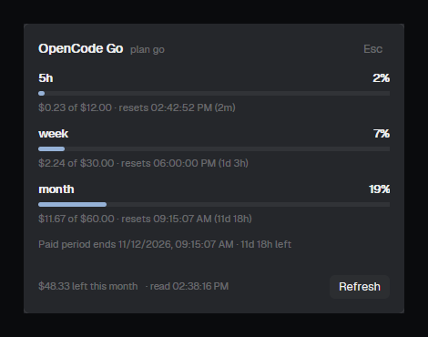

# OpenCode Go usage bar for Herdr

Your OpenCode Go plan usage in Herdr's bottom bar: the rolling 5-hour window,
the UTC week and the paid month, each with the percentage used and a countdown
to its reset. A refresh icon sits next to the numbers; clicking the numbers
opens a small dialog with the dollars behind each percentage.


Unlike other usage meters for this provider, nothing here is estimated: the
numbers are the plan's own meters, read from the same status endpoint the
Console's Go page uses.

## What you get

- **One chip per window** — `5h 1% (1h 5m) · week 7% (1d 4h) · month 19% (11d 19h)`.
  Percentages turn amber at 75% and red at 95%.
- **Countdowns in the bar**, so you know whether to start that long task now.
- **A refresh icon** next to the numbers. It spins while a read is in flight.
- **A detail dialog** (420×288) with what the bar cannot hold: dollars spent
  against each window's limit, the exact local reset time, when the paid period
  ends, and how much budget is left this month.
- **Real errors** — no login, expired session, wrong shape, no network: the bar
  shows `! OpenCode Go` and the dialog says what to do next.

## The dialog



Click the numbers in the bar to open it. It shows what the bar has no room for:
`$used of $limit` per window, the exact local reset time next to the countdown,
when the paid period ends, and how much monthly budget is left. `Refresh` asks
the bar to read again; `Esc` closes it.

## Requirements

- Herdr, with mods (tested on the Herdr app 0.7.1 / herdr-core 0.9.5).
- opencode v2, run at least once, with the **Console account** connected:
  in opencode run `/connect`, then `OpenCode Console account`. That login is
  what this reads; the inference API key in `auth.json` is not it.
- Python 3 on `PATH` as `python`, `python3` or `py`.

## Install

Copy both mod folders into Herdr's mods directory:

```sh
cp -r mods/opencode-usage mods/opencode-usage-detail ~/.config/herdr-app/mods/
herdr-app check ~/.config/herdr-app/mods/opencode-usage
herdr-app check ~/.config/herdr-app/mods/opencode-usage-detail
```

Both must print `check passed`. Then put the bar in a layout you own — clone the
shipped one first, never edit it:

```sh
herdr-app do layout.clone '{"name":"main","as":"main-usage"}'
```

In `~/.config/herdr-app/layouts/main-usage.json`, replace the bottom `status`
block with a 28px row holding the bar and the status block:

```json
{
  "id": "footer",
  "type": "row",
  "size": { "px": 28 },
  "children": [
    {
      "id": "usage",
      "type": "block",
      "size": { "weight": 1.35 },
      "min": 340,
      "content": { "mod": "opencode-usage" }
    },
    {
      "id": "status",
      "type": "block",
      "size": { "weight": 1 },
      "content": { "mod": "workspace-status" }
    }
  ]
}
```

Saving a `.js` reloads a mod in place; `mod.json` and layout changes want an app
restart.

## Commands

| Command | What it does |
| --- | --- |
| `opencode-usage.refresh` | Read the plan again now |
| `opencode-usage.details` | Open the detail dialog |

Bind them to a key in `keys.json` if you like, or run them with
`herdr-app do opencode-usage.refresh`.

## Where the numbers come from

`mods/opencode-usage/collect.py` is the only part that touches the network or a
credential. It is a plain Python 3 script with no dependencies, and you can run
it on its own:

```sh
python mods/opencode-usage/collect.py          # human readable
python mods/opencode-usage/collect.py --json   # what the mod consumes
python mods/opencode-usage/collect.py --db /path/to/opencode.db
```

It reads the **OpenCode Console** OAuth credential that opencode stores in its
own database (`<data dir>/opencode.db`, table `credential`, the row with
`integration_id = 'opencode'` and `type: "oauth"`), then asks
`GET https://opencode.ai/console/api/go/status` for the plan meters. They arrive
as `limitMicroCents` / `usedMicroCents` (1e8 microcents = 1 USD), so the
percentage is exact and no plan tier is hardcoded — if the plan changes, the
numbers follow.

Exit codes: `0` success, `2` a known condition (no login, expired session,
offline, no database — with a message and a next step), `1` unexpected.

## Security and privacy

This is the part worth checking before you install it:

- The database is opened **read-only** (`file:...?mode=ro`) and never written;
  the WAL is not checkpointed.
- The token is used **only** as an `Authorization` header towards
  `opencode.ai`. It is never printed, logged, stored or copied into Herdr's
  shared state.
- The refresh token is never touched. Re-authenticating is left to opencode.
- The mod publishes a **sanitized** snapshot (label, dollars, percent, reset
  time) to Herdr's shared state. A test asserts a credential cannot reach the
  rendered output.
- Nothing is sent anywhere else, and nothing is collected. There is no telemetry
  and no account identity in any output.
- `opencode.db` may be large; only two columns of one row are read.

## Limitations

- One account, the one opencode is connected to.
- The Console device login lasts about 30 days. When it expires the bar says so;
  reconnect with `/connect` in opencode. This mod deliberately does not refresh
  it.
- The status endpoint is internal and undocumented: it can change without
  notice. When it does, the bar shows a specific reason instead of wrong
  numbers.
- The numbers describe the plan, not the harness: any agent using that API key
  shows up in them.

## Cost

Measured on Windows: a full read is about 440 ms, of which ~300 ms is waiting on
HTTPS and ~30 ms is interpreter startup. Every two minutes that is roughly 0.4%
of one core, in a half-second burst that is mostly idle waiting. The bar redraws
once a minute to move the countdowns. `REFRESH_MS` in `mods/opencode-usage/main.js`
is the only knob worth turning.

## Development

```sh
python -m unittest discover -s tests -v          # 10 offline tests
herdr-app check mods/opencode-usage                # bar
herdr-app check mods/opencode-usage-detail         # dialog
herdr-app check mods/opencode-usage-detail --print-spec   # what it built
```

Two things that will bite you if you refactor:

- **The dialog is a separate mod on purpose.** An overlay reuses the copy of a
  mod that already lives in the layout and does not hand it new props, so a
  `detail` prop never arrives; the dialog would render the bar inside a big box.
  Opening a mod of its own avoids that entirely.
- **`format.js` is duplicated** in both folders because a mod cannot import from
  outside its own folder (`herdr-app check` fails with
  `module ... resolves outside the application directory`). Copy it to both.

`RECIPE.md` is the full brief behind this mod: look, behaviour, data contract and
the traps above, enough for an agent to rebuild it from an empty folder.

## License

MIT. Not affiliated with opencode or Herdr.
