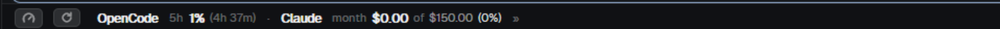
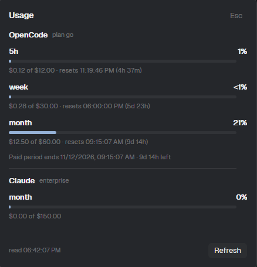

# Agent usage bar (OpenCode Go + Claude)

A thin bar at the bottom of the window that shows how much of each agent plan is
spent. For **OpenCode Go**: the rolling 5-hour window, the UTC week and the paid
month. For **Claude**: whatever the Claude Code session on this machine reports —
the five-hour session, the week, per-model windows, or dollars when the account
bills by use. The bar opens compact (one window per provider) and a click on the
numbers shows every window; a gauge icon opens a dialog with the details. Nothing
is estimated: the numbers are the providers' own meters.



## What you see

**In the bar** (28px tall, full width of the block it is given, left to right):
a 13px gauge icon in `muted` that opens the dialog, then one group per provider
separated by a `dim` middle dot. A group is the provider name at 11.5px semibold
in `foreground` followed by its chips: `OpenCode 5h 1% (1h 5m) · Claude 5h 12%
(3h 40m)` in compact mode, `OpenCode 5h 1% · week 7% · month 19% · Claude 5h ·
week · opus · sonnet` in full mode. Inside a chip the window label is `dim`, the
headline number is semibold (a percentage, or the dollars spent when the account
bills by use), and the countdown is `dim` in parentheses. A percentage at or
above 75 turns `working`, at or above 95 `blocked`, and between 0 and 1 it reads
`<1%` (over 99 reads `>99%`). The chips group, the gauge and the refresh icon all
highlight on hover. Background `chrome`, a 1px top border in `border`, and the
refresh icon is a 12px circular arrow that spins while the reads are in flight.

Measured on the default dark theme: `foreground` `#eeeeef`, `dim` `#696a6d`,
`muted` `#98999b`, `raised` `#2c2e31`, `popover` `#25272b`, `accent` `#96b2d7`.
Every color is taken from `theme()` by name, so a light theme follows.



**In the dialog** (440×420, `popover` background, 16px padding, 10px gaps): a
header with `Usage` at 14px semibold and an `Esc` button on the right, then one
section per provider separated by a 1px `border` rule. A section starts with the
provider name at 13px semibold plus its plan in `dim` 10.5px, then one block per
window: the label and its headline number on one line, a 388×5px meter under it
(track `hover`, fill `accent` / `working` / `blocked`, rounded 3px), and under
that, in `dim` 11px, `$0.14 of $12.00 · resets 02:42:52 PM (1h 5m)` — the money
part only when the provider reports dollars. OpenCode adds
`Paid period ends 11/12/2026, 09:15:07 AM · 11d 19h left`; Claude adds an
`extra usage` row when the account has a credit pool. A footer holds
`read 01:29:49 PM` in `dim` 10.5px and a `Refresh` button on the right.

When there is no reading yet the bar shows `Usage ···`. A failure replaces a
provider's chips with `! Claude` in `blocked`, with the reason and the next step
in its tooltip, and the dialog spells both out in that provider's section.

## How it behaves

The bar reads as soon as it first shows and every 120000ms afterwards, reading
both providers one after the other; it redraws every 60000ms only to move the
countdowns. Nothing animates on a timer: the only motion is the refresh icon
spinning (native, 900ms per turn) while a read is running.

**Clicking the numbers switches views.** Compact (the default) shows one window
per provider, the five-hour one; full shows every window. The choice is written
to `localStorage["opencode-usage.compact"]` (`"1"` compact, `"0"` full) so it
survives a restart, and `format.js` reads it through `compact()` / `setCompact()`.
Clicking the gauge icon opens the dialog as a plain dialog overlay, 440×420, with
a scrolling middle so a bigger UI font cannot clip the footer. Clicking the
refresh icon, or `Refresh` in the dialog, starts a read in the bar; the dialog
never reads by itself, it only re-renders when the shared snapshot changes, and
its footer time updates with it. `Esc` or the header button closes it. Agent
states (working, blocked, done, idle) do not affect any of it: only consumption
sets a color.

`<mod>.refresh`, `<mod>.details` and `<mod>.toggle` are delivered to the bar's
`nextCommand()`, so `herdr-app do opencode-usage.refresh`, `... .details` and
`... .toggle` do what the clicks do. There are no global keys and no `keys.json`
snippet is needed.

Failures keep their reason and their provider: no Console login, an expired
session (HTTP 401), a refused read (403), rate limiting (429), no network, a
database that is not there, a response with no meters, Claude Code signed out,
and a Claude response with nothing usable each produce a specific sentence and a
next step, never a blank bar.

## Built from

Two mods, because of the first trap under **Watch out**:

```
mods/opencode-usage/        main.js, format.js, mod.json, collect.py,
                            collect_claude.py, gauge.svg, refresh.svg
mods/opencode-usage-detail/ main.js, format.js, mod.json
```

`mods/opencode-usage/mod.json` is `{"place": "none", "size": 28, "overlay":
{"width": 470, "height": 380}}`; the detail mod's is `{"place": "none", "size":
28, "overlay": {"width": 440, "height": 420}}`. Both default-export a gpui-kit
`View`; there is no other entry point. The folder id keeps the name
`opencode-usage` because it is what installed layouts reference.

The bar uses `theme()`, `appHome()`, `exec()`, `setShared()`, `shared()` through
`format.js`, `openOverlay()` and `nextCommand()`. It publishes one reading for
both providers to shared key `opencode-usage.snapshot`:
`{fetched_at, providers:[{id, name, plan, windows[], money, period_ends_at,
updated, error, code, action, failure}]}`. The dialog uses `theme()`, `props()`,
`closeOverlay()` and `run("opencode-usage.refresh")`. Both `format.js` copies hold
the same helpers: `snapshot()`, `providers()`, `compact()`, `setCompact()`,
`primaryWindow()`, `percentLabel()`, `meterPercent()`, `windowLabel()`,
`usageColor()`, `barColor()`, `money()`, `moneyPair()`, `countdown()`, `stamp()`,
`clockTime()`, `share()`.

The programs either mod runs are the two helpers, with
`["<appHome>/mods/opencode-usage/<helper>", "--json"]`, trying `python`, then
`python3`, then `py`, and remembering which one worked. Both are Python 3,
standard library only.

`collect.py` (OpenCode Go) opens `<data dir>/opencode.db` read-only
(`file:...?mode=ro`), takes the `value` JSON of the newest `credential` row with
`integration_id = 'opencode'`, `active = 1` and `type: "oauth"`, then calls
`GET https://opencode.ai/console/api/go/status` with that access token as a
Bearer header (10s timeout, 1 MiB cap, redirects refused). `access.meters`
carries `{fiveHour, week, month}` with `limitMicroCents` and `usedMicroCents`,
1e8 microcents per USD; percent is used/limit×100, and a reported zero limit
means "no limit", never 0%. It prints
`{provider, product, period_ends_at, windows[{key,label,used_usd,limit_usd,percent,resets_at}], updated}`.

`collect_claude.py` (Claude) reads `<config dir>/.credentials.json`
(`~/.claude`, or `CLAUDE_CONFIG_DIR`), takes `claudeAiOauth.accessToken`, and
calls `GET https://api.anthropic.com/api/oauth/usage` with
`anthropic-beta: oauth-2025-04-20` — the same call behind Claude Code's `/usage`
(10s timeout, 1 MiB cap, redirects refused). It accepts both response shapes:
a `limits` array with `kind` (`session`, `weekly_all`, `weekly_opus`,
`weekly_sonnet`) and the named buckets (`five_hour`, `seven_day`, …). Each window
keeps `utilization` when the account reports it and `used_dollars` /
`limit_dollars` when it bills by use; `extra_usage` becomes `money`. `expiresAt`
is read as milliseconds when it is at least 1e11 and as seconds otherwise; an
expired session is reported as `expired` and never refreshed. It prints
`{provider, title, plan, windows[...], money, updated}`.

Both exit 0 with a reading, or 2 with `{windows: [], error, code, action}`.

In a layout it is a block in a 28px row, next to `workspace-status`:

```json
{ "id": "footer", "type": "row", "size": { "px": 28 }, "children": [
  { "id": "usage", "type": "block", "size": { "weight": 1.35 }, "min": 340,
    "content": { "mod": "opencode-usage" } },
  { "id": "status", "type": "block", "size": { "weight": 1 },
    "content": { "mod": "workspace-status" } } ] }
```

The art is two small SVG files: `gauge.svg` (a needle under an arc) and
`refresh.svg` (a circular arrow), both `stroke="currentColor"` so `svg()` tints
them with the text color.

## Watch out

- **The dialog must be its own mod.** An overlay reuses the copy of a mod that
  already lives in the layout and does not hand it new props, so a `detail` prop
  never arrives and the dialog renders the bar inside a big empty box. Opening a
  second mod by name is what works.
- **A mod cannot import from outside its own folder.** `herdr-app check` fails
  with `module ... resolves outside the application directory`. `format.js` is
  duplicated on purpose; copy it to both folders when you change it.
- `div().bg(raised)` inside a `popover` dialog is nearly invisible; meter tracks
  need `hover` or `border`. And `foreground` as a 1%-wide fill reads as a stray
  line: use `accent` for the fill and keep `working` / `blocked` for thresholds.
- `exec()` resolves with `{code, stdout, stderr}` even on a nonzero exit and only
  rejects when the program cannot start, so the exit-2 error JSON is read and
  published like any other reading. On Windows `python3` may be the Store stub
  that resolves to a different interpreter; the helper is tried in order for
  that reason.
- The Console device login lasts about 30 days. When it expires the bar asks for
  `/connect` again; the helper deliberately does not touch the refresh token,
  because rotating it breaks the owner's login.
- The status endpoint is internal and undocumented: it can change without
  notice, which is why a response without meters is reported as `no_quota`
  instead of showing zeros.
- Only the bar copy fetches. Adding a timer to the dialog would double the reads
  and the two copies would race on the shared snapshot.
- One account per provider: whichever Console login opencode has stored and
  whichever account Claude Code is signed in to. The numbers describe that plan
  or that account, so any agent using it shows up in them. Claude usage from this
  machine is not an organization-wide spend report; that would need the Admin API
  and an `sk-ant-admin` key.
- **The numbers are the view toggle, the gauge is the dialog.** Do not put both on
  the same element: a click can only mean one thing, and losing the compact mode
  to a dialog is the worse trade.
- **An empty Claude credential file is "signed out", not a transient error.**
  Claude Code leaves `.credentials.json` with `accessToken: ""` and
  `expiresAt: 0` when it has no session; check the token, not the file,
  otherwise the bar claims a session it does not have.
- **Claude's endpoint is OAuth-only.** A workspace API key cannot read it, and it
  returns 401 for anything but a live Claude Code token. Treat every 401 as "sign
  in again", never as "retry later".

## Done when

- `herdr-app check mods/opencode-usage` and `herdr-app check mods/opencode-usage-detail`
  both print `check passed`, and `herdr-app check ... --print-spec` shows one
  provider group per reading and a 388-wide meter in each dialog window row.
- With a connected Console login the OpenCode group shows its windows with real
  percentages and countdowns that move once a minute; the dialog shows dollars,
  exact reset times and the paid period end.
- With Claude Code signed in the Claude group shows the windows the account
  reports (percentages, or dollars for a usage-billed account) and the dialog
  adds the extra-usage row when the account has a credit pool.
- Clicking the numbers switches between the compact view (one window per
  provider) and the full one, and the choice survives an app restart; clicking
  the gauge opens the dialog; `herdr-app do opencode-usage.toggle` does the same
  as the click.
- `python mods/opencode-usage/collect.py` prints the OpenCode windows and exits 0;
  with `--db /nonexistent` it exits 2 with a message and a next step, no
  traceback. `python mods/opencode-usage/collect_claude.py` exits 0 with a reading
  when signed in, and exits 2 with `not_signed_in` and the `claude auth login`
  next step when not.
- Without a Console login the OpenCode group reads `! OpenCode` and the dialog
  names `/connect` as the next step; without a Claude Code session the Claude
  group reads `! Claude` and the dialog names `claude auth login`.
- `python -m unittest discover -s tests -v` passes: 29 offline tests over
  synthetic data, including one per provider asserting a credential cannot reach
  the rendered output.
